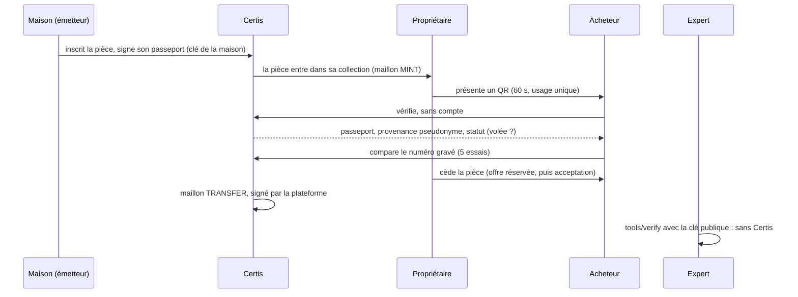

# Certis — le registre vérifiable des montres d'occasion

Le passeport d'une montre, signé par la maison qui l'atteste. Sa provenance, chaînée et signée à chaque changement de mains. Et une vérification que n'importe quel acheteur peut faire sans compte, et qu'un expert peut refaire **sans faire confiance à Certis**.


**Démo vidéo (34 s)** : [`docs/demo/certis-demo.mp4`](docs/demo/certis-demo.mp4), ou en GIF ci-dessous.

## En 60 secondes

- **Le problème.** Acheter une montre d'occasion, c'est croire des papiers qui se photocopient et un vendeur qu'on ne connaît pas.
- **Ce que fait Certis.**
  - Seule une maison inscrit une pièce : elle signe son passeport avec sa propre clé, publiée.
  - Chaque cession, révision ou vol devient un maillon de chaîne, que la base de données interdit de réécrire.
  - L'acheteur scanne un QR à usage unique et voit la pièce, sa provenance, et si son numéro de série correspond.
  - Une pièce déclarée volée ne peut plus changer de mains, et tout acheteur qui la vérifie est alerté.
- **Ce qui le prouve.**
  - Tests d'attaque écrits en rouge avant chaque correctif : [`9fd0503`](https://github.com/Niwa-Yume/certis/commit/9fd0503), [`f1df856`](https://github.com/Niwa-Yume/certis/commit/f1df856).
  - [Décisions argumentées (ADR)](docs/adr) et [modèle de menace](docs/security/THREAT_MODEL.md).
  - Un [vérificateur indépendant](tools/verify) qui signale le maillon modifié.
  - Accessibilité contrôlée (axe, WCAG 2.2 AA), [captures](docs/screenshots) mobile, tablette et desktop.


## Comment ça marche



## Lancer en local (une commande)

Prérequis : Node.js 24 (`.nvmrc`, Node 22 convient aussi) et Docker Desktop.

```bash
npm run dev
```

Cette commande :
- démarre PostgreSQL (Docker) et installe les dépendances manquantes ;
- crée `backend/.env` avec des secrets neufs, ou complète celui qui existe ;
- applique les migrations et charge les données de démo ;
- lance l'API (http://localhost:3001) et le web (http://localhost:8090).

Elle affiche aussi l'adresse à ouvrir depuis un téléphone du même réseau. `Ctrl+C` arrête tout.

| Commande | Effet |
|---|---|
| `npm run demo` | Le cycle de vie complet d'une pièce, en 8 étapes ([déroulé de la démo](docs/DEMO_SCRIPT.md)) |
| `npm run demo -- 6` | Rejouer une étape seule, sur une pièce neuve |
| `node tools/verify/verify.mjs preuve.json jwks.json` | Vérifier un passeport et sa chaîne sans Certis |
| `npm --prefix backend run db:reset` | Repartir d'une base de démo propre |
| `npm --prefix backend run test:e2e` | Tests e2e (base isolée `certis_test`) |
| `npm --prefix backend run issuer:grant -- <e-mail> "<maison>"` | Faire d'un compte l'émetteur d'une maison |
| `npm --prefix backend run issuer:revoke -- <kid> [date ISO]` | Révoquer une clé d'émetteur compromise (ADR-0011) |

Comptes de démo, en dev uniquement (mots de passe dans `backend/prisma/seed.ts`) :

| Compte | Rôle |
|---|---|
| `atelier@certis.demo` | Émetteur fictif « Atelier de démonstration » |
| `certis@pro.com` | Propriétaire : Submariner Date, Royal Oak Extra-Plat |
| `julien.castro@certis.local` | Propriétaire : Carrera Calibre S, reçue par cession |

## Périmètre

| Travail de bachelor (CREA, avril à août 2026) | Repris après le jury (octobre 2026) | Hors périmètre |
|---|---|---|
| App Expo et API NestJS, comptes, inscription d'une montre par son propriétaire, QR de vérification et de cession, signature ECDSA par la plateforme, historique des cessions. État exact : `main` @ `9de1082`, audité dans [`docs/AUDIT.md`](docs/AUDIT.md). | Audit et backlog. Failles de cession corrigées, tests rouges d'abord. Modèle émetteur, passeport signé, chaîne d'événements, vol, numéro de série. Vérificateur indépendant. Interface refaite (desktop, accessibilité). Démo rejouable. | Blockchain, intégration Aura ou Arianee, paiements, publication sur les stores, puce NFC, Verifiable Credentials W3C, ancrage chez un tiers horodateur (reporté). |

Projet personnel, sans affiliation avec aucune maison horlogère. Il ne contient aucun code, document ni information issus de mes stages, et n'engage aucune entreprise. Les marques et références des données de démonstration appartiennent à leurs propriétaires ; l'émetteur de démonstration est fictif.

## Ce qui a changé après le jury

| Critique du jury | Réponse | Statut |
|---|---|---|
| Faille de transfert : le nonce n'était pas lié à la montre | La faille et 3 failles voisines corrigées, chaque attaque rejouée en test ([chaînes A à N](backend/test/transfer-attacks.e2e-spec.ts)) | Fait |
| Interface desktop basique, en dessous des standards du luxe | Direction « Registre » (ADR-0009), responsive, accessibilité vérifiée | Fait |
| Démo sommaire, écart entre promesse et livré | Émetteur, passeport, chaîne, vol, numéro de série, vérificateur, démo rejouable en 8 étapes | Fait |
| Manque de méthode | Audit, backlog MoSCoW, ADR, tests rouges, bilan par phase | En cours |
| Confusion bachelor, stage et entreprise | Rebrand neutre, section « Périmètre » ci-dessus | Fait |
| Gestion du temps | Démo de 10 min chronométrée, répétitions journalisées | En cours |

Le détail, preuve par preuve : [`docs/JURY_FEEDBACK_MAP.md`](docs/JURY_FEEDBACK_MAP.md).

## La sécurité, en bref

- **Cession** : nonce lié à la pièce, à une finalité et, au choix, à un destinataire. Consommation atomique (ADR-0002), pièce verrouillée si déclarée volée.
- **Authenticité** : seule une maison inscrit. Son passeport est une JWS ES256 sur du JSON canonique (RFC 8785), vérifiable avec la JWKS publique (ADR-0003, ADR-0004).
- **Provenance** : chaîne par pièce. Base append-only (trigger), sans fourche possible (`UNIQUE`). Aucune identité réelle dans la chaîne, seulement des pseudonymes ; un compte supprimé n'y est plus rattachable (ADR-0006, RGPD).
- **Numéro de série** : jamais stocké. Seule une empreinte HMAC l'est, et la comparaison est limitée à 5 essais (ADR-0005).
- **Limites assumées** : Certis garde les clés des maisons pour la démo, un QR prouve l'enregistrement et non l'objet, l'ancrage est reporté. Détail : [modèle de menace](docs/security/THREAT_MODEL.md).

## Stack

Expo 54, React Native, Expo Router (mobile et web) · NestJS 11, Prisma 7, PostgreSQL 16 · `node:crypto` (ECDSA P-256, AES-256-GCM, HKDF), aucune bibliothèque cryptographique tierce · Render et Neon pour le déploiement ([ADR-0008](docs/adr/0008-hebergement-render-neon.md)).

## Déploiement (Render + Neon)

1. Créer une base sur Neon (offre gratuite) et copier sa chaîne de connexion **directe**.
2. Générer la clé de signature : `node backend/scripts/generate-secrets.mjs`. N'en copier que la ligne `ECDSA_PRIVATE_KEY` : `JWT_SECRET` et `KEY_ENCRYPTION_KEY` sont générés par Render. Ne plus jamais changer `KEY_ENCRYPTION_KEY` ensuite : elle chiffre les clés des maisons.
3. Sur Render, *New → Blueprint* sur ce dépôt. Renseigner pour `certis-api` :
   - `DATABASE_URL` ;
   - `ECDSA_PRIVATE_KEY` ;
   - `CORS_ORIGINS`, l'URL de `certis-web`.

   `TRUST_PROXY_HOPS` vaut 1 par hypothèse, à vérifier au premier déploiement ([modèle de menace](docs/security/THREAT_MODEL.md)).
4. Une fois l'API en ligne, renseigner `EXPO_PUBLIC_API_URL` pour `certis-web` et relancer le site.
5. Créer un compte dans l'app, puis le faire émetteur : `npm --prefix backend run issuer:grant -- <e-mail> "<maison>"`, avec les variables de production.

L'API refuse de démarrer si une variable manque ou est trop faible : le message liste chaque problème.

## Documentation

- [Audit de départ](docs/AUDIT.md), [backlog et bilans de phase](docs/BACKLOG.md), [critiques du jury → preuves](docs/JURY_FEEDBACK_MAP.md)
- [Décisions (ADR)](docs/adr), [modèle de menace](docs/security/THREAT_MODEL.md), [référence de l'API](backend/docs/api/endpoints.md)
- [Déroulé de la démo](docs/DEMO_SCRIPT.md), [vérificateur indépendant](tools/verify/README.md), [captures](docs/screenshots)
- [Vision marché 2027-2030](docs/market/MARKET_VISION.md), notes d'une page : [Fondation Dominique Renaud](docs/onepagers/FONDATION_DOMINIQUE_RENAUD.md), [recruteurs](docs/onepagers/RECRUTEURS.md)
